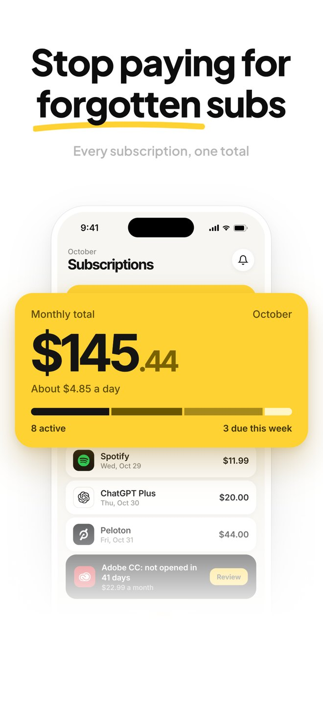
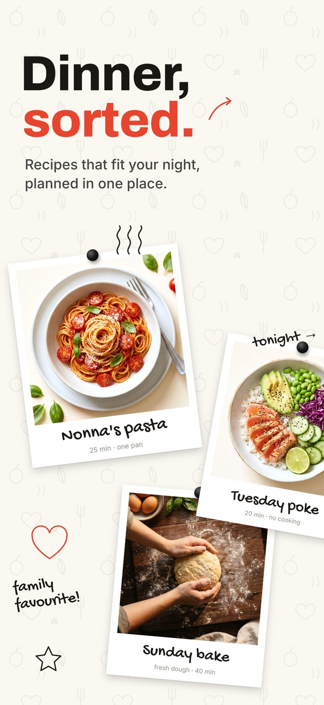
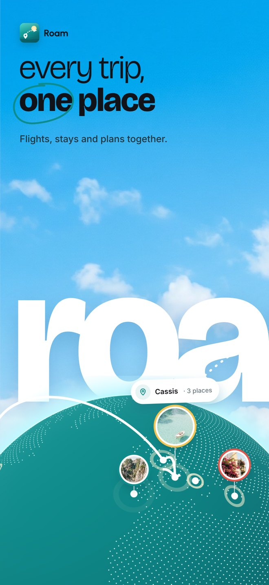
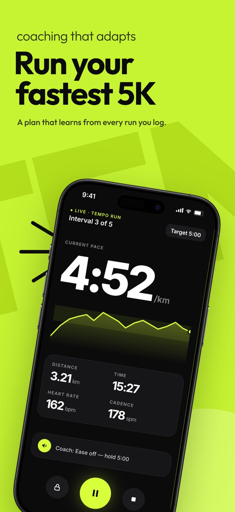
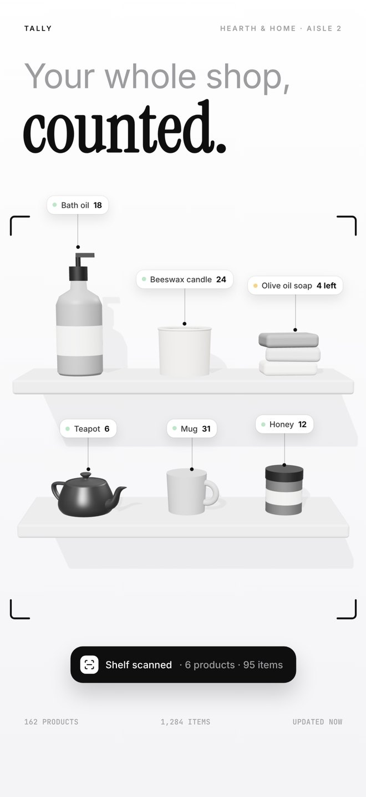
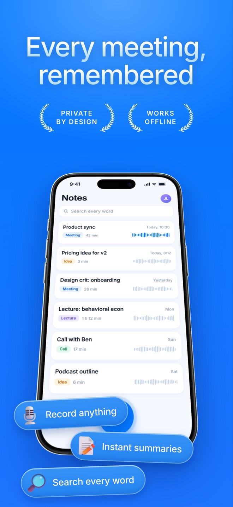
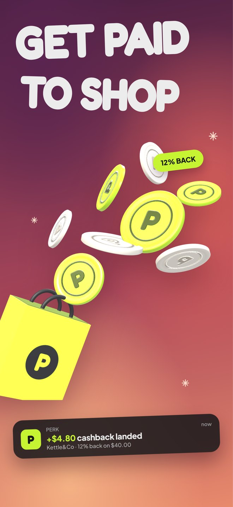

# ASO Shots

**App Store screenshots that sell.** A skill for Claude Code that turns your app's raw screenshots into a store-ready screenshot set: it writes the copy, offers three directions, builds the set in HTML and exports PNGs at the exact App Store and Google Play sizes.

18 proven styles. One skill.

| SubPal | Mise | Roam | Tempo |
|---|---|---|---|
|  |  |  |  |

| Tally | Murmur | Perk |
|---|---|---|
|  |  |  |

## Install

**Claude Code (plugin).** Inside Claude Code, run:

```
/plugin install aso-shots --marketplace ceorkm/aso-shots
```

On Claude Code older than 2.1.275, add the marketplace first, then install:

```
/plugin marketplace add ceorkm/aso-shots
/plugin install aso-shots@aso-shots
```

**Any agent (skills CLI).** Works with Claude Code, Codex, Cursor and other agents:

```bash
npx skills add ceorkm/aso-shots
```

Add `-g` to install it for every project, or `-a claude-code` to pick the agent.

## Use it

Attach your app's screenshots and ask:

> Use ASO Shots to redesign these App Store screenshots.

Or run it directly with `/aso-shots:app-store-screenshots`.

## How it works

1. **Intake.** Your screenshots, what the app does, any proof you have (ratings, users, press), your brand and how many screenshots you need.
2. **Understand the app** from its screens and listing.
3. **Storyboard.** The words come first: one headline per screenshot, approved before any design.
4. **Pick a style** from the 18 in the library, chosen for your app and audience.
5. **Three directions** for screenshot 1. You pick one.
6. **Assets.** Backgrounds, people, objects and mascots are generated with AI (Codex, OpenAI or Google) when the style needs them. Your real app UI is never redrawn by AI.
7. **Build** the full set in HTML/CSS/JS.
8. **Check and export** at store size with no alpha channel: iPhone 6.9" (1320 × 2868), 6.3" (1206 × 2622), iPad and Google Play.
9. **Revise** until it is right.

## The 18 styles

| | | |
|---|---|---|
| 01 Scrapbook Collage Panorama | 07 Sticker Headline | 13 Electric Blue Glass Pills |
| 02 Sky Collage Panorama | 08 Glow Night | 14 Orange Frame Clean Showcase |
| 03 Mascot Pop | 09 Glass Collage | 15 Red Sticker Drop |
| 04 Brand Blocks | 10 Bold Color Blocks + 3D Mascots | 16 Sky Glass Creator Pop |
| 05 Floating UI | 11 Bubbly Sticker Rewards | 17 Periwinkle Paper Plane Organizer |
| 06 Mascot Hype | 12 Lime Highlight Travel Mockups | 18 Editorial Mono Serif Mix |

Each style is a design system (palette logic, type pairing, panel treatment, decoration and device treatment), described in `skills/app-store-screenshots/styles/NN-*/design.md`.

## Requirements

- [Claude Code](https://claude.com/claude-code)
- Node 18+ and Playwright for exporting: `npm i playwright && npx playwright install chromium`
- Python 3 with numpy and Pillow (for cutting out generated assets)
- For AI assets, one of: the Codex plugin, `OPENAI_API_KEY` or `GEMINI_API_KEY`

## Repository layout

```
.claude-plugin/                Plugin and marketplace manifests (for /plugin install)
skills/app-store-screenshots/  The skill: SKILL.md, the 18 styles, copywriting, build and asset guides, scripts
showcase/final/                The seven example sets at 1320 × 2868 (+ the Roam app preview video)
showcase/site/                 A one-page showcase of all seven sets
showcase/<app>/                The HTML builds behind each set (Three.js pages need a local server:
                               python3 -m http.server 8793 inside showcase/)
subpal/                        A full before and after: SubPal's old App Store screenshots, the three
                               directions board and the new 6.9" and 6.3" exports
```

## Scripts

| Script | What it does |
|---|---|
| `scripts/export.js` | Exports every `.panel` of a screenshots page as store-ready PNGs. `node export.js page.html out ios-6.9` |
| `scripts/gen_image.py` | Generates one image asset with OpenAI GPT Image or Google Nano Banana |
| `scripts/chroma_key.py` | Turns a green-screen image into a transparent PNG |
| `scripts/fetch_listing.py` | Downloads an App Store listing's screenshots and details |
